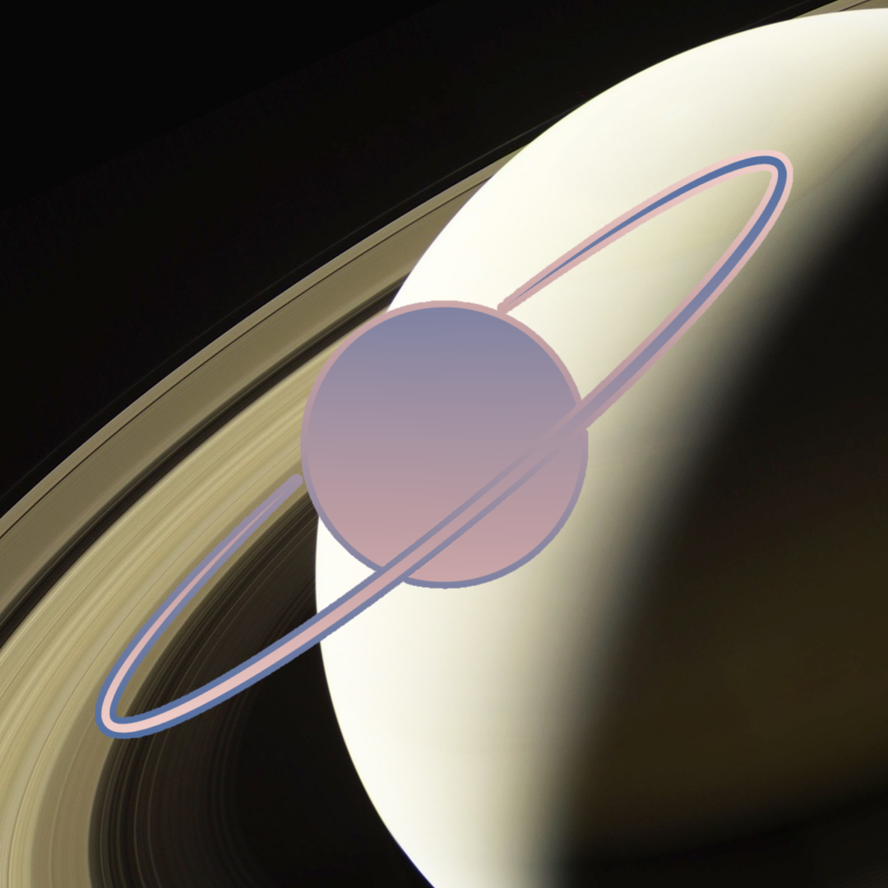
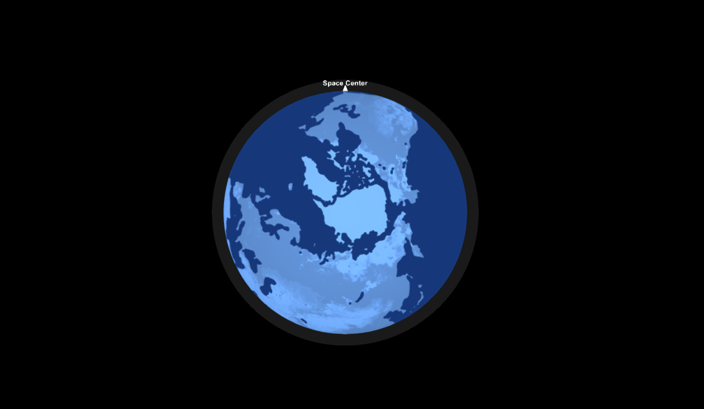
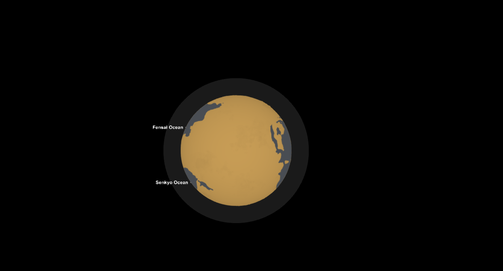
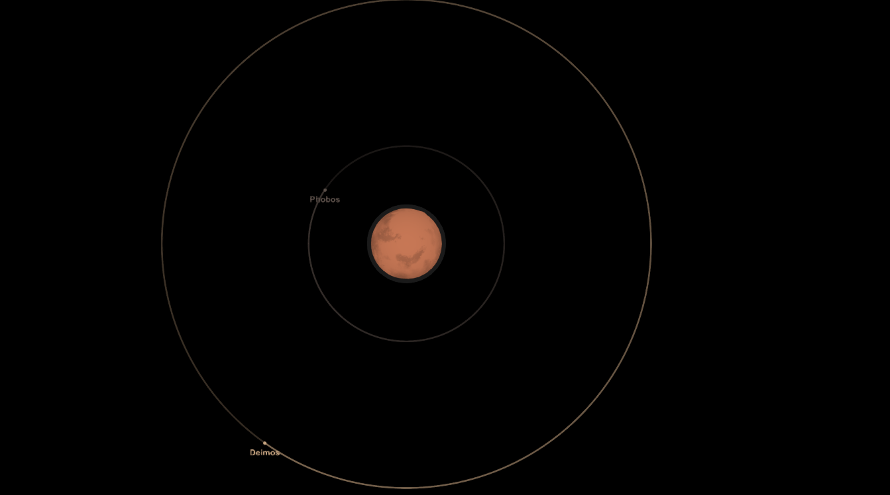
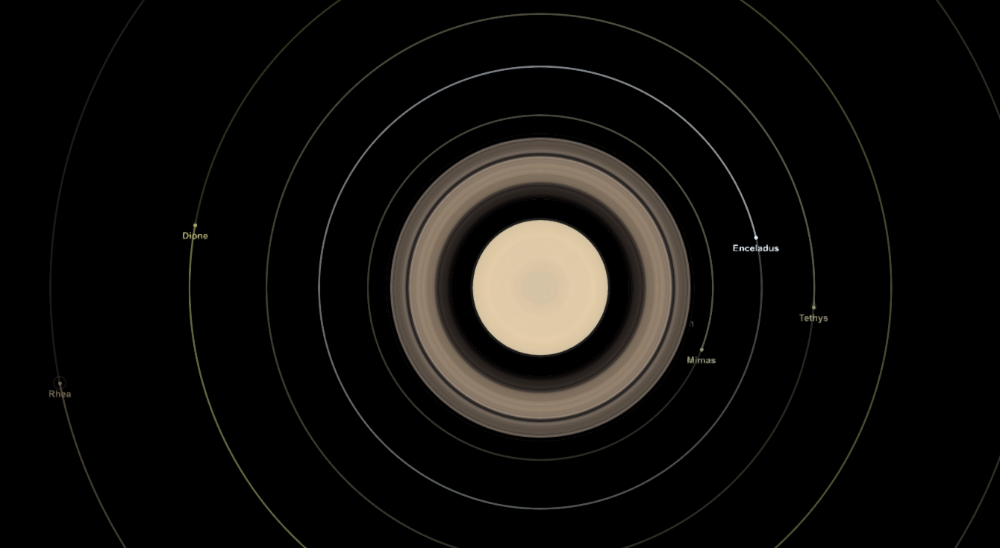
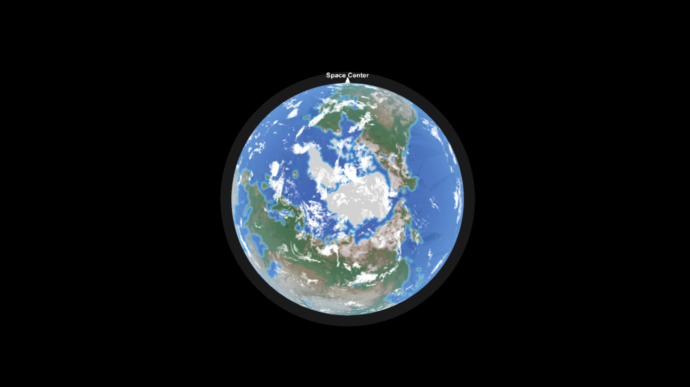
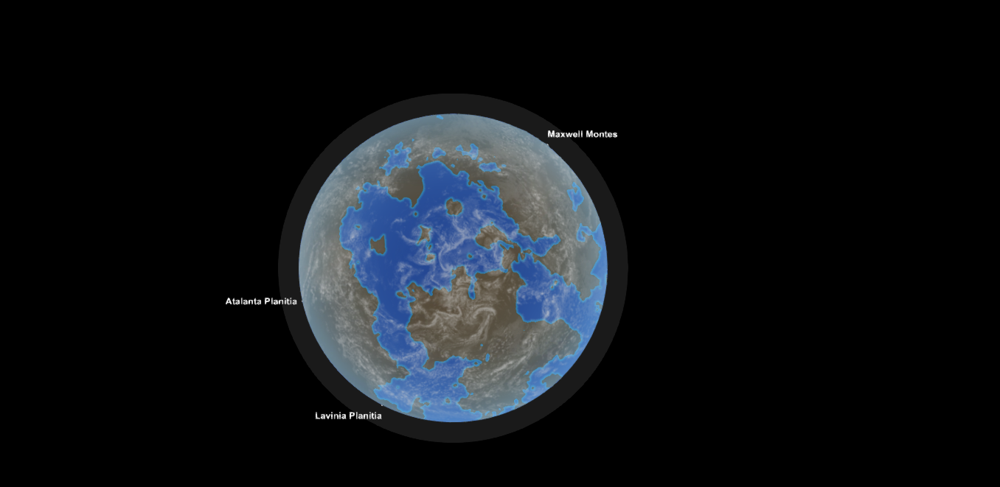

# </img> Icon Map

A code mod for [Spaceflight Simulator](https://store.steampowered.com/app/1718870/) (SFS) It changes the planet icons on the map to look better

## Screenshots

---

## 1. About the mod

Icon Planet changes how planets are displayed on the map. Instead of using the same bland circles for every type of planet, you get distinct icons representing features like water, terrain, clouds, and fog
The workflow utilizes various mask files for rendering, such as water masks or cloud masks
The mod features two modes: Smooth and High

**Smooth**
- Water covers the entire planet
- Soft planet textures
- Color tones based on "mapColor"
- Faint rings
- For planets lacking terrain, clouds are used for the visual display

---

**High**
- Planet-wide water and shallow water depth
- Full planetary textures
- Planetary atmosphere/fog
- Realistic rings
- Visible clouds

## 2. How it works & how to use

1. Open the **map**  
2. Press **P** to cycle icons  

You can change the key in **Settings** anytime

---

## 3. Mod support

As mentioned earlier, this mod reads mask files rather than using pre-made images, so it supports other mods!
Simply install custom Solar System and give it a try

## License

Non-commercial use only — see the [LICENSE](LICENSE) file.

You may use, modify, and share this mod for free community purposes.
Selling or using it for profit is not allowed without permission.
# Authorship & Credits

* </img> **Luna Tomato**
  * [GitHub Profile](https://github.com/tomato9946) | [YouTube Channel](https://www.youtube.com/channel/UCv2v5wErevqbt4HJkFUhe2A) | [Spaceflight Simulator Thailand Discord](https://discord.gg/SfTGQAhJJP) | [Forums Profile](https://sfsforum.com/index.php?members/rotten-tomato.26818/)
